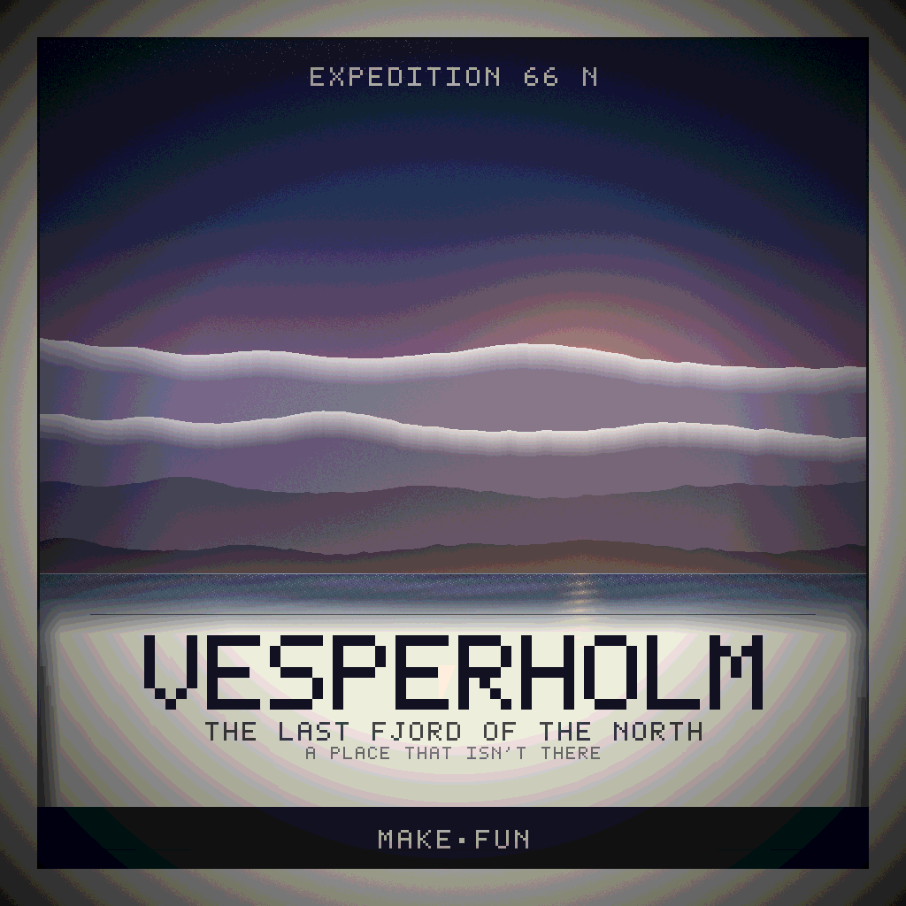

# The Poster for a Place That Isn't There

[](https://make.fun/bounty/the-poster-for-a-place-that-i-2-20261121-0539)
[](https://make.fun/bounty/the-poster-for-a-place-that-i-2-20261121-0539/leaderboard)
[](https://make.fun/bounty/the-poster-for-a-place-that-i-2-20261121-0539)

Entry for make.fun's [the-poster-for-a-place-that-i-2-20261121-0539](https://make.fun/bounty/the-poster-for-a-place-that-i-2-20261121-0539).

**VESPERHOLM — the last fjord of the north.** A travel poster for a place that does not exist.



## How it is made

`main.ts` (Node 22, zero dependencies, no network) renders the whole poster
procedurally and writes it to `/output/entry.png`:

- value-noise / fBm terrain ridges with snow caps and sun-side rim light
- dithered sky gradient, star field, cloud bands, horizon haze
- water with wave-perturbed shading, sun glitter path and ridge reflections
- pine silhouettes and a sailboat for foreground depth
- letterpress cream title plate with a hand-built 5×7 bitmap display face
- film grain, vignette and a printed paper frame
- a from-scratch PNG encoder (zlib deflate, CRC32) — no image libraries

## Run

```bash
node main.ts && file /output/entry.png
```

Output: 1024×1024 PNG, well under the 1 MiB cap.

## Licence

MIT — see `LICENSE`.
